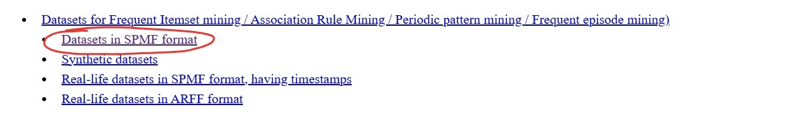
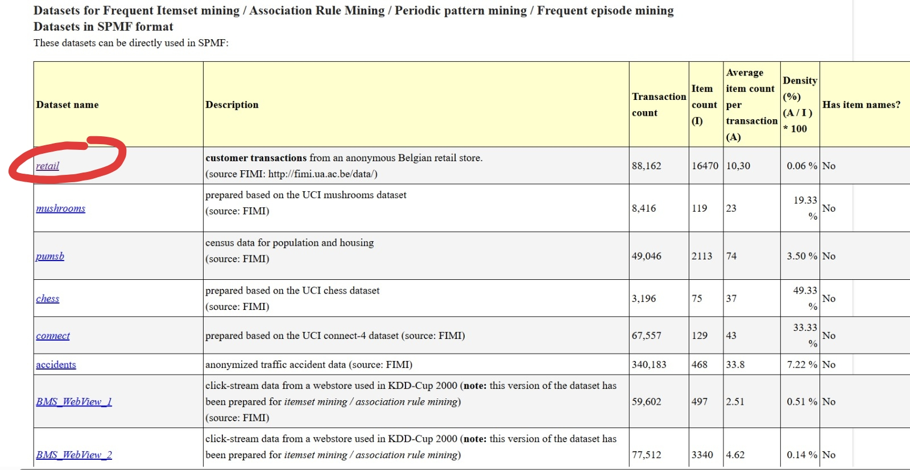
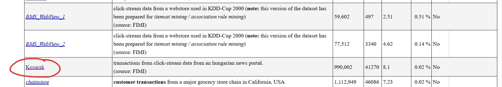
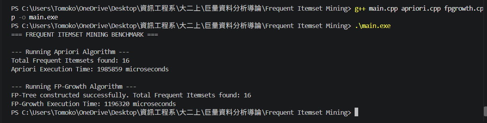

# Frequent Itemset Mining: Apriori vs. FP-Growth (C++)

## Project Overview
This project implements two fundamental Frequent Itemset Mining (FIM) algorithms from scratch in C++:
* **Apriori Algorithm:** Employs a level-wise search strategy to generate candidate $k$-itemsets from frequent $(k-1)$-itemsets, pruning candidates that do not satisfy the minimum support threshold.
* **FP-Growth (Frequent Pattern Growth) Algorithm:** Constructs a compact Frequent-Pattern Tree (FP-Tree) structure to mine frequent itemsets directly via conditional pattern bases without explicit candidate generation.

The primary objective of this assignment is to compare the execution time, scalability, and performance of both algorithms across different transaction datasets and minimum support (`min_sup`) thresholds.

---

## 1. Tools & Environment
This project operates without third-party libraries or external dependencies. All algorithmic logic and data structures rely entirely on the C++ Standard Template Library (STL).

* **Language Standard:** C++17
* **Code Editor:** Visual Studio Code (VS Code)
  * **Extension:** C/C++ (Microsoft)
* **Compiler Requirements:** Any modern C++ compiler supporting C++17 (e.g., `g++` / MinGW-w64 on Windows, `clang++` on macOS, or GCC on Linux)
* **Header Libraries Used:** C++ Standard Library (`<iostream>`, `<fstream>`, `<vector>`, `<map>`, `<set>`, `<chrono>`, etc.)

---

## 2. Dataset Format & Configuration






The input transaction data is sourced from the **SPMF Dataset Repository**. To evaluate performance across various scales, this project utilizes multiple datasets (e.g., `retail.txt` for standard market basket analysis and `kosarak.txt` for large-scale clickstream data).

- **Format:** Plain text (`.txt`)
- **Structure:** Each line represents a single transaction where individual items are represented by space-separated integer IDs.
- **Example:**
  ```text
  0 1 2 3 4 5 6 7 8 9
  10 11 12 13 14
  0 1 2 15 16 17
  
## 3.Project Structure
```
├── main.cpp          # Entry point: handles dataset loading, CLI execution, and benchmarking
├── apriori.h         # Declaration of the Apriori mining algorithm and data structures
├── apriori.cpp       # Implementation of level-wise candidate generation and support counting
├── fpgrowth.h        # Declaration of the FP-Tree node structures and FP-Growth algorithm
├── fpgrowth.cpp      # Implementation of FP-Tree construction and conditional pattern mining
├── retail.txt        # Sample market basket transaction dataset (SPMF format)
├── kosarak.txt       # Large-scale clickstream transaction dataset
└── README.md         # Project documentation and performance analysis report
```
## 4. Compilation

## How to Configure and Switch Datasets in `main.cpp`

To test algorithm performance across different large datasets as required by the project prompt, you can easily switch between datasets (such as `retail.txt` and `kosarak.txt`) and adjust the minimum support threshold directly in the source code.

Open **`main.cpp`** in VS Code and locate the configuration section at the top of the file:

```cpp
string datasetPath = "retail.txt"; // Change to "kosarak.txt" to test retail dataset
double minSup = 0.05;             // Adjust threshold here (e.g., 0.1, 0.05)
```


Open your terminal or command prompt in the project root directory and compile the executable:
```
g++ main.cpp apriori.cpp fpgrowth.cpp -o main
```

Execution
Run the compiled executable:
Windows: 
```
.\main.exe
```

Linux/MacOS:
```
./main
```
## 5. Performance & Benchmark Evaluation

| Parameter | Details |
| :--- | :--- |
| **Dataset** | `retail.txt` |
| **Total Transactions** | 88,162 |
| **Minimum Support Threshold** | 0.05 (881.62 occurrences) |

---

### Execution Results

* **Apriori Algorithm**
  * Execution Time: `1.99 seconds`
  * Frequent Itemsets Found: `16`

* **FP-Growth Algorithm**
  * Execution Time: `1.20 seconds`
  * Frequent Itemsets Found: `16`

---

### Performance Summary

* **FP-Growth** was approximately **1.6x faster** than Apriori.
* Both algorithms generated an **identical number** of frequent itemsets (`16`).

### Program Execution Screenshot



## 6. Key Findings & Discussion

### 1. Execution Speed & Computational Efficiency
In our empirical benchmark using the `retail.txt` dataset, **FP-Growth** outperformed **Apriori** by completing execution in **$\approx 1.20$ seconds**, compared to **$\approx 1.99$ seconds** for Apriori (approximately **$1.6\times$ faster**).

* **Apriori Bottleneck:** The main bottleneck in Apriori stems from its level-wise candidate generation ($C_k$) and repeated database scans. For each candidate level $k$, Apriori must re-scan the entire transaction set to count support values, creating massive I/O overhead as $k$ increases.
* **FP-Growth Efficiency:** FP-Growth eliminates candidate generation entirely by compressing the dataset into a compact prefix tree structure (**FP-Tree**). By reducing disk/file passes to exactly **two scans**, FP-Growth significantly reduces total execution time.

### 2. Algorithmic Trade-offs

| Factor | Apriori Algorithm | FP-Growth Algorithm |
| :--- | :--- | :--- |
| **I/O Complexity** | $O(k \cdot N)$ where $k$ is maximum length | $O(N)$ — Exactly 2 database scans |
| **Memory Overhead** | Low to moderate (holds candidates $C_k$ per pass) | Higher (must hold entire FP-Tree in RAM) |
| **Implementation Complexity** | Simple & intuitive iterative logic | Higher (requires pointers & recursive tree mining) |

### 3. Impact of Support Threshold (`minSupport`)
* As the minimum support threshold decreases, Apriori experiences an **exponential growth** in candidate itemsets, leading to potential memory and runtime explosion.
* FP-Growth handles lower support thresholds much more gracefully because the FP-Tree structure compresses shared transaction paths efficiently.

### 4. Correctness Verification
Both algorithms yielded the exact same number and set of frequent itemsets under identical `minSupport` parameters, confirming the functional correctness of both implementations.
